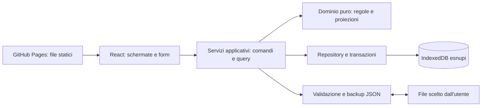

# Architettura

## Forma generale

SPA statica eseguita nel browser. GitHub Pages distribuisce HTML, JavaScript, CSS e asset; il browser conserva i dati finanziari. Nessun server applicativo.



## Stack e motivazioni

- **React + TypeScript strict:** componenti, moduli di funzionalità e contratti espliciti per gli agenti.
- **Vite:** sviluppo e build statica in `dist/`, con base `/esnupi/` quando il repository usa quel nome.
- **CSS con custom properties:** tema fumetto specifico, senza dipendere dallo stile di un UI kit.
- **IndexedDB + idb:** archivio strutturato asincrono, indici e transazioni tra più store. idb adatta l'API a Promise.
- **Hash routing:** URL come `/esnupi/#/movimenti`; refresh e link profondi non richiedono rewrite del server.
- **Vitest** per dominio e servizi; **Testing Library** per interazioni rilevanti; **Playwright** per pochi percorsi completi su build statica. Fissare versioni compatibili in T0.

Stato UI locale ai componenti; provider applicativo per caricamento, servizi e invalidazione dei dati. Non aggiungere Redux, Zustand o un secondo cache layer per impostazione predefinita. Numeri sintetici e barre semplici possono essere costruiti con HTML/CSS; nessuna libreria grafici iniziale.

## Struttura prevista

```text
src/
  app/                   # bootstrap, router, provider, navigazione
  domain/
    money.ts             # parsing e aritmetica intera
    calendar.ts          # date civili, mesi, scadenze
    types.ts             # contratti condivisi
    ledger.ts            # operazioni e proiezione saldi
    budget.ts            # rollover, piano e copertura
    recurrence.ts        # occorrenze attese, funzioni pure
    goals.ts             # simulazioni e disponibilità
  application/
    commands/            # casi d'uso con commit atomico
    queries/             # viste derivate
    reconcile.ts         # scadenze e piano mensile
    ports.ts             # repository, clock, ID
  infrastructure/
    db/                  # schema IndexedDB, repository, migrazioni
    backup/              # schema JSON, import/export, validazione
  features/
    onboarding/
    dashboard/
    transactions/
    envelopes/
    goals/
    recurring/
    settings/
  shared/ui/             # input importo, dialog, notifiche, stati vuoti
  styles/                # token, reset, layout e componenti
public/assets/           # illustrazioni, font, icone serviti localmente
tests/                   # integrazione, fixture sintetici, E2E
docs/
design-system/
.github/workflows/       # CI e deploy GitHub Pages
```

Questa è la mappa implementata della prima versione. Dominio, persistenza, riconciliazione, schermate e workflow sono collegati a dati reali. Consultare [HANDOFF.md](HANDOFF.md) per verifiche e limiti effettivi.

## Confini

Il dominio riceve record e data di riferimento, restituisce risultati oppure errori tipizzati. Non conosce React, IndexedDB o `Date.now()`.

I servizi applicativi leggono lo stato necessario e applicano un comando in una transazione. Copertura e uscita, registrazione di un'occorrenza e relativo movimento, applicazione del piano e suo marcatore di esecuzione sono unità atomiche.

Il repository espone snapshot e transazioni; soltanto l'adapter accede a IndexedDB. La UI usa query e comandi, non manipola gli store direttamente. Non mostrare «Salvato» prima del commit; su errore mantenere il form e offrire un tentativo successivo.

## Ciclo di apertura

1. Aprire archivio e completare eventuali migrazioni.
2. Caricare impostazioni e configurazioni versionate.
3. Se onboarding assente, mostrare setup o importazione.
4. Conciliare le scadenze dalla data iniziale fino alla data corrente inclusa, in ordine cronologico.
5. Derivare rollover e saldi; tentare il piano soltanto al suo innesco previsto.
6. Mostrare riepilogo di operazioni generate, deficit e interventi richiesti.

Ripetere riconciliazione al cambio di giorno mentre l'app è aperta e al ritorno in primo piano. Se l'intervallo da recuperare è ampio, elaborare batch con progresso e possibilità di ripresa. Vincoli univoci sugli identificativi impediscono doppioni anche tra due tab. Un'altra tab viene informata dopo commit, ad esempio con BroadcastChannel; la correttezza resta garantita dal DB.

Nessun service worker nella prima versione. I dati possono restare nel browser anche senza rete, ma l'avvio dell'app offline non è garantito.

## Fonti tecniche

- [GitHub Pages: hosting statico](https://docs.github.com/en/pages/getting-started-with-github-pages/what-is-github-pages).
- [Vite: deploy statico e base per GitHub Pages](https://vite.dev/guide/static-deploy.html).
- [MDN: IndexedDB, transazioni e same-origin](https://developer.mozilla.org/en-US/docs/Web/API/IndexedDB_API).
- [idb: documentazione del progetto](https://github.com/jakearchibald/idb).
- [MDN: quote e rimozione dei dati del browser](https://developer.mozilla.org/en-US/docs/Web/API/Storage_API/Storage_quotas_and_eviction_criteria).

Consultate l'11 novembre 2026. Il disegno dei moduli è una scelta del progetto, non una prescrizione delle fonti.
